  

  

  

  

  
  
  
  
  

---

<h3 align="center">CORE ENGINEERING DISCIPLINES</h3>

  <table width="100%">
    <tr>
      <td width="50%" align="center" valign="middle">
        
          
        
      </td>
      <td width="50%" align="center" valign="middle">
        
          
        
      </td>
    </tr>
    <tr>
      <td width="50%" align="center" valign="middle">
        
          
        
      </td>
      <td width="50%" align="center" valign="middle">
        
          
        
      </td>
    </tr>
    <tr>
      <td colspan="2" align="center" valign="middle">
        
          
        
      </td>
    </tr>
  </table>

---

<h3 align="center">GITHUB AWARDS & TROPHY RECOGNITION</h3>

  

---

<h3 align="center">TECHNICAL STACK & ARCHITECTURE</h3>

  

<h4 align="center">Game Development, 3D Physics & Engines</h4>

  
  
  
  
  
  
  

<h4 align="center">Programming Languages</h4>

  
  
  
  
  
  
  
  
  
  

<h4 align="center">Frameworks & Mobile / Web Engines</h4>

  
  
  
  
  
  
  
  
  
  

<h4 align="center">Databases & Cloud Architecture</h4>

  
  
  
  
  
  
  
  
  

<h4 align="center">DevOps, Systems & Tooling</h4>

  
  
  
  
  
  
  
  
  

---

<h3 align="center">GITHUB PERFORMANCE & VISUAL ANALYTICS</h3>

  
  

  
  

  

---

<h3 align="center">CONNECT & COLLABORATE</h3>

  
  

  

